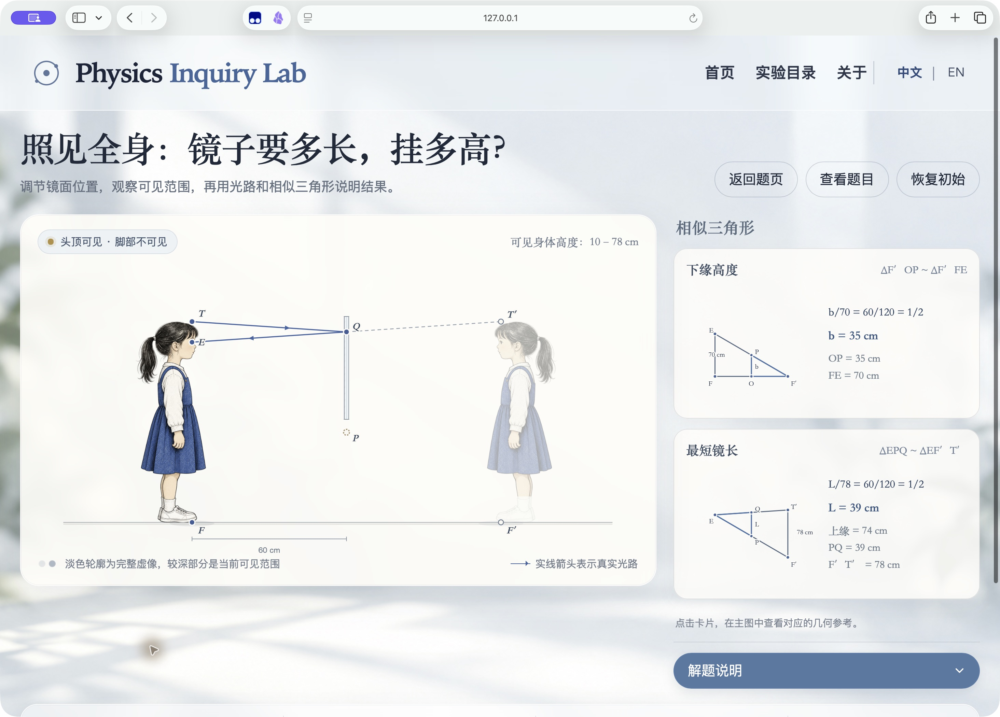
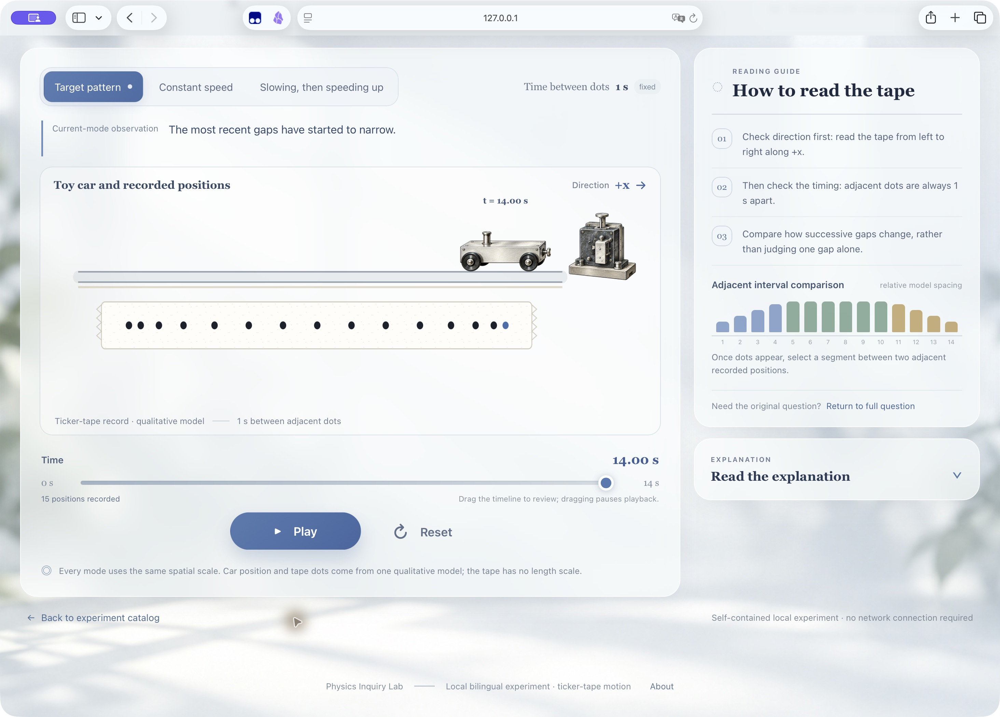

# Physics Inquiry Web

*Turn physics questions into bilingual, interactive browser labs.*

**v4.1.0｜首次公开发行**

把一道完整物理题转成可操作的中英双语实验网页。流程是：上传题目 → 助手判断题型与适配度、整理设计报告和逐屏效果图 → 你确认本题方案 → 生成可在浏览器直接打开的本地 HTML → 如有需要，再选择可用的托管方式。每道新题都要单独确认设计；初始化或之前的确认不会替新题授权。

## 下载与安装

1. 从 [GitHub Releases 最新发行页](https://github.com/jiaweihuang1224-arch/physics-inquiry-web/releases/latest) 下载完整附件 `physics-inquiry-web.zip`，也可使用[完整包直链](https://github.com/jiaweihuang1224-arch/physics-inquiry-web/releases/latest/download/physics-inquiry-web.zip)。
2. 解压 ZIP，保留整个 `physics-inquiry-web` 文件夹及其中的 `SKILL.md`、`assets/`、`references/`、`scripts/`。
3. 按下方对应客户端说明安装完整包。公开 Release 下载不需要私有仓库权限或 GitHub 私有令牌。

- **Codex：** 若已有 `~/.codex/skills/physics-inquiry-web/`，在原目录更新完整文件，不要另建同名副本。首次安装时使用当前客户端支持的 Skill 目录；通用目录通常为 `~/.agents/skills/`。新会话中调用 `physics-inquiry-web`。
- **WorkBuddy：** 在技能面板使用自定义技能导入入口，上传完整 ZIP。
- **Kimi：** Kimi Work 的导入入口按当前客户端为准；Kimi Code 可把完整目录放入 `~/.kimi-code/skills/physics-inquiry-web/`，再按其技能命令调用。
- **其他助手：** 只要助手能读取和写入项目文件、制作或编辑 HTML/JavaScript，并让你在本地浏览器打开交付文件，就可以按说明手动提供 Skill 文档与题目；没有 Codex 也能使用本地 HTML 流程。

普通 GitHub Release 不等于已上架任一客户端的技能商店。平台入口与验证范围见[平台与验证边界](references/platforms.md)和[安装与使用](references/sharing-and-use.md)。

## 第一次使用

在准备保存实验的项目中调用 Skill，并发送：

> 使用 physics-inquiry-web，开始首次初始化。请先确认当前工具能力，询问我要做单实验还是分类目录、是否需要在线托管，以及本地保存位置。以后每道新题先给设计报告和逐屏效果图，等我确认这道题的方案后再制作；默认交付浏览器可直接打开的本地 HTML。

初始化只保存你选择的项目偏好，不会自动开始新题，也不会替后续题目确认方案。

## 以后添加新题

在同一项目中附上完整题干、题图、全部条件和选项，并发送：

> 使用 physics-inquiry-web，按当前项目设置分析我随消息附上的新题。请先判断题型与适配度，给出物理分析、设计报告和逐屏效果图；等我确认这道题的方案后再制作。确认后交付中英双语、浏览器可直接打开的本地 HTML。

你可以选择**单实验**，也可以选择持续增加实验的**分类目录**。目录模式会把实验整理到主题分类中；一个 HTML 也可以包含主页、目录、题页和实验多个视图。自动分类与设计建议不等于预装了所有题型的实验库：目前只有平面镜案例随包提供可运行源码，其他题目需要按新题重新分析、设计和验证。

## 效果参考与当前实现

主页图片是**设计参考，不是当前实现截图**。

下面两张是 Safari 中打开本地预览的实际浏览器截图，不是生产站截图；两张均为原样纳入本包的 JPEG 图片。

**平面镜案例｜Safari 本地预览。** 调整镜底和镜长，观察虚像可见范围与相应三角形关系。该案例的可运行源码包含在包内。

**纸带计时实验｜Safari 本地预览。** 来自同一制作流程的实际纸带实验画面，展示时间播放与暂停、模型对照和区间选择。此发行包仅收录镜子可运行参考，纸带源码未收录。

## 运行要求与验证边界

学生打开已交付的本地 HTML 不需要安装 Python 或 Node，也不需要运行开发脚本；使用普通浏览器即可。`scripts/` 中的工具只用于制作、检查或重现随包案例，是可选的开发工具。

Codex、Sites 与本地 HTML 有既往实际验证记录；当前客户端是否提供文件、浏览器或托管工具，仍需在使用时核对。WorkBuddy 与 Kimi 的入口按官方资料和客户端界面核对过，但因测试账号额度限制，本包尚未完成这些平台上的端到端生成与托管测试。不要把平台文档或入口存在视为本包已在该平台通过验证。

## 素材和许可

素材身份与使用边界见[包内素材说明](references/package-assets.md)。本包没有额外指定开源许可证；公开可下载不等于已经取得或转授所有第三方素材权利。请按素材实际来源和许可决定进一步使用。
